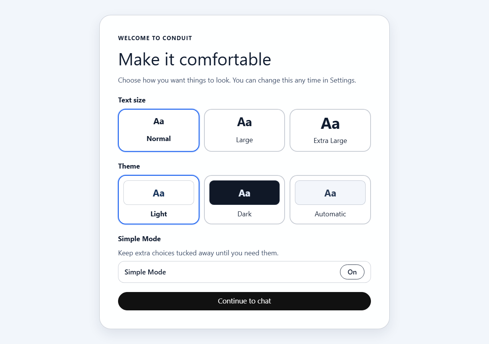
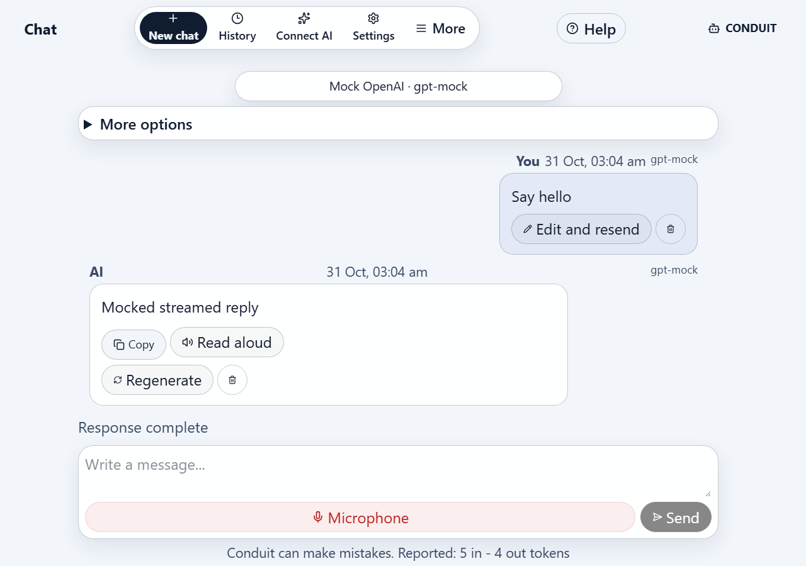
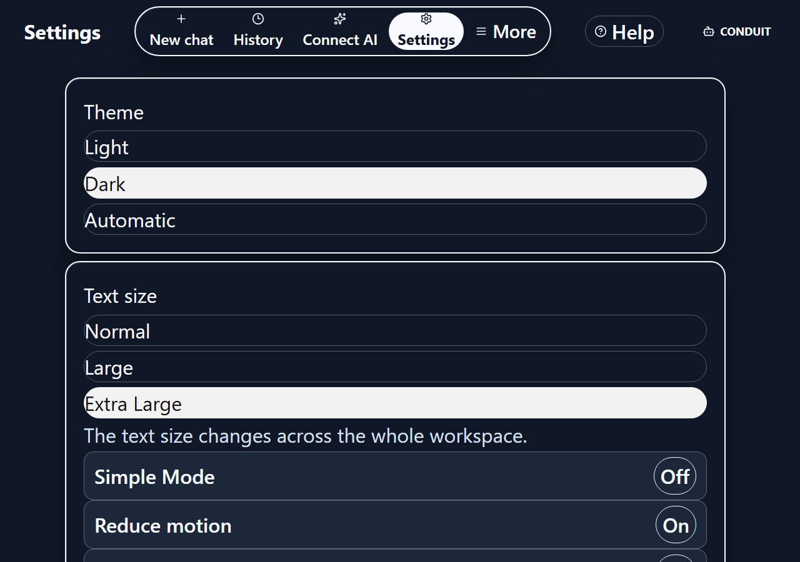

# CONDUIT V3.0

CONDUIT is a local, single-device multi-provider chat app. From the repository root, the pnpm workspace scripts launch the full chat client and its local API service in [apps/web](./apps/web/).

## Requirements

- Node.js 20 or newer
- Corepack (bundled with supported Node.js releases) and pnpm
- An API key from a supported provider to send chat messages

## Run locally

```powershell
corepack pnpm install
corepack pnpm dev
```

Open the Vite URL printed in the terminal (normally `http://localhost:5173`). The dev command starts both the chat UI and the local API service. Use `corepack pnpm dev:web` and `corepack pnpm dev:api` to run them separately.

The chat app's navigation menu includes **Prompt library** with 50 searchable, categorized starters you can copy into a conversation, plus **Credential reference** for the all-types catalog and session-only forms. Use **API Config** to add provider keys for actual conversations. The standalone reference UI is also available with `corepack pnpm dev:reference` (normally `http://localhost:5174`).

## Set up chat

The local API service reads its encryption key from the repository-root `.env`. Generate a private 32-byte key and add it to that file:

```powershell
$key = corepack pnpm --silent generate:key
$envFile = ".env"
$lines = if (Test-Path $envFile) { Get-Content $envFile | Where-Object { $_ -notmatch '^CONDUIT_ENCRYPTION_KEY=' } } else { @() }
$lines += "CONDUIT_ENCRYPTION_KEY=$key"
$lines | Set-Content -Encoding ascii $envFile
Remove-Variable key, lines, envFile
```

The workspace opens without a password. On first launch, the app creates a non-extractable AES-GCM key in the browser's IndexedDB and uses it to encrypt chats and settings. Existing password-protected V3 vault data is not imported into the new workspace and remains encrypted in IndexedDB; export it before upgrading if you need to preserve it.

Encrypted backups use a separate password that you choose when exporting and enter when importing. Keep a backup if you need to move the workspace to another browser or device.

For an individual conversation, open **More options** in the chat to export it as Markdown or JSON. To restore a JSON export, open **History** and choose **Import chat**; the imported conversation opens with its messages and generation settings, ready to continue. API credentials are not included in chat exports.

Open **API Config** and add a real supported provider key. CONDUIT validates it with the provider and stores it encrypted in the local API service. Select the connection and a chat model, return to the chat, and send a message. Provider usage may incur charges. To add multiple keys, export an Excel sheet as CSV with one key per row or an **API key** column; CONDUIT checks keys sequentially and saves only valid keys (up to 10 connections). Validation checks provider model access and does not send chat messages.

The chat composer accepts multiple files and folders. Text files are included as text, images are converted to English OCR text in the browser, and other binary formats are encoded as base64 text so their contents can still be sent to text-only chat APIs. Image data stays in the browser; the English OCR model is downloaded from jsDelivr on first use. The combined message is limited to 180,000 characters, and oversized attachments are reported instead of being silently truncated.

API Config has one input for supported AI chat credentials and identifies known
key formats as you type; the provider is confirmed by validation before the key
is saved. Unknown formats require consent before CONDUIT checks supported chat
providers. This is not a universal API credential connector: payment, cloud,
database, and other non-chat credentials require dedicated provider
integrations and cannot be used for chat. All keys are saved in the single
Default environment automatically; the app does not ask users to configure
environments.

The local API listens on `127.0.0.1:3001` and the web app normally runs at `http://localhost:5173`.

The experimental typed API is disabled by default. To opt in to its current
health/OpenAPI endpoints, set `CONDUIT_FEATURE_TYPED_API=1` in the repository
root `.env` before starting the API. Browser code uses the corresponding
`VITE_CONDUIT_FEATURE_TYPED_API=1` build flag. The V3 Express API remains the
default and continues serving existing routes.

## Build and test

```powershell
corepack pnpm build
corepack pnpm test
```

`corepack pnpm build` builds the chat app. `corepack pnpm test` runs the repository test suite. Use `corepack pnpm preview` to serve the production build locally.

## Keyboard shortcuts

- **Ctrl/Cmd + K** opens the command palette from anywhere in the workspace.
- Type to find app commands or search conversation titles and messages; use **Up/Down** and **Enter** to select.
- **Ctrl/Cmd + Shift + N** starts a new chat.
- **Ctrl/Cmd + ,** opens Settings.
- Press **Escape** to close the palette and return focus to where you were.

The palette can also change the theme, text size, contrast, motion, transparency, and Simple Mode without leaving the current page.

## Security

Provider credentials are sent only to the local API service for validation and chat, then encrypted at rest. Chat history and settings are encrypted in IndexedDB. The device vault key is stored in the same browser profile, so this is not a password or authentication boundary: anyone with access to the browser profile or code running in the app origin may access the workspace. Do not expose the local API service to an untrusted network or commit `.env` files.

## Design system and accessibility

The UI uses shared React components from [packages/ui/src/index.tsx](./packages/ui/src/index.tsx) and app CSS design tokens in [apps/web/src/index.css](./apps/web/src/index.css). The Settings page lets you change text size, theme, Simple Mode, motion, transparency, and contrast. These preferences are saved with the encrypted local workspace. The interface uses system fonts and makes no remote font or image requests.

Keyboard and screen-reader labels, visible focus rings, reduced-motion and reduced-transparency support, high-contrast surfaces, and responsive navigation are covered by the web tests. The Playwright smoke test runs axe on the chat screen in light and dark themes, then checks the composer at 360, 768, 1280, and 1920 pixels.







Some limits remain: speech input depends on browser support and microphone permission; the interface is currently English-only; and Safari, Firefox, Edge, 400% browser zoom, and mobile screen readers still need manual verification.
